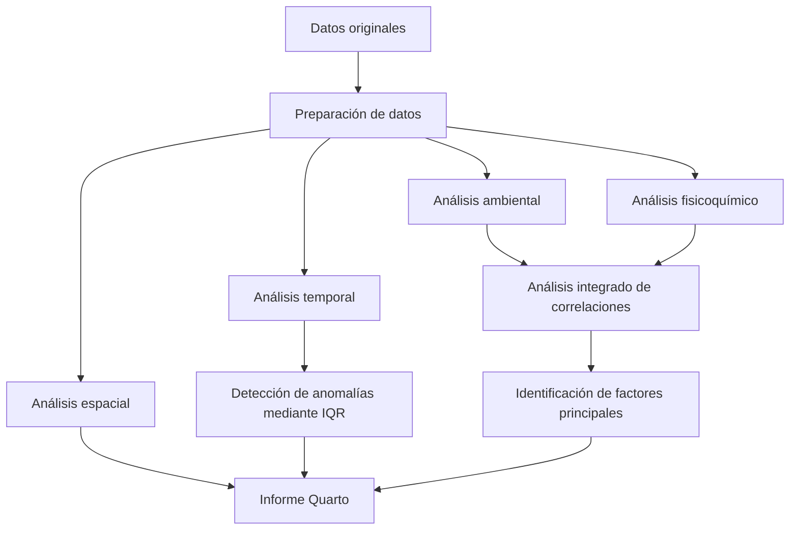
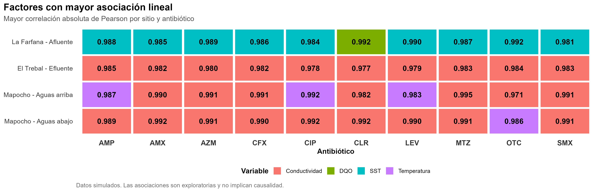

# Análisis exploratorio de antibióticos en aguas residuales y sistemas fluviales

## Descripción del proyecto

La presencia de antibióticos como contaminantes emergentes en sistemas acuáticos representa un desafío ambiental y sanitario debido a su potencial persistencia, eliminación incompleta mediante tratamientos convencionales y posible contribución al desarrollo de resistencia antimicrobiana.

Este repositorio tiene como finalidad desarrollar un análisis exploratorio utilizando datos generados mediante inteligencia artificial. El conjunto de datos representa diez días de monitoreo en plantas de tratamiento de aguas residuales (PTAR) y puntos de muestreo del río Mapocho.

Se consideran concentraciones de contaminantes emergentes, variables ambientales (temperatura y precipitación), parámetros de calidad del agua (pH, conductividad, DBO y DQO) y caudal.

**Los datos son simulados y no representan mediciones ambientales reales.** 

## Objetivo general

Explorar la variabilidad espacial y temporal de las concentraciones de antibióticos en PTAR y puntos de muestreo fluviales, evaluando posibles relaciones con variables ambientales y parámetros de calidad del agua mediante herramientas estadísticas y de visualización.

## Pregunta central

¿Cómo varían las concentraciones de antibióticos en sistemas acuáticos y qué relaciones presentan con las condiciones ambientales y fisicoquímicas?

## Preguntas exploratorias

1. ¿Cómo varían las concentraciones de antibióticos entre los diferentes puntos de muestreo?
2. ¿Qué patrones temporales presentan las concentraciones durante los diez días analizados?
3. ¿Qué relaciones exploratorias existen entre las concentraciones, el caudal y la temperatura?
4. ¿Es posible identificar puntos de muestreo con concentraciones relativamente elevadas?

## Descripción del conjunto de datos

La base de datos fue generada mediante simulación y representa diez días de monitoreo de antibióticos en aguas residuales y superficiales.

### Antibióticos considerados

| Abreviatura | Antibiótico |
|---|---|
| AMP | Ampicilina |
| AMX | Amoxicilina |
| AZM | Azitromicina |
| CFX | Cefalexina |
| CIP | Ciprofloxacino |
| CLR | Claritromicina |
| LEV | Levofloxacino |
| MTZ | Metronidazol |
| OTC | Oxitetraciclina |
| SMX | Sulfametoxazol |

Las concentraciones se expresan en ng/L.

### Variables explicativas

| Categoría | Variable | Unidad |
|---|---|---|
| Ambiental | Temperatura del agua | °C |
| Climática | Precipitación diaria | mm |
| Hidrológica | Caudal | m³/s |
| Fisicoquímica | pH | Adimensional |
| Fisicoquímica | Oxígeno disuelto | mg/L |
| Fisicoquímica | Conductividad eléctrica | µS/cm |
| Fisicoquímica | Demanda química de oxígeno | mg/L |
| Fisicoquímica | Sólidos suspendidos totales | mg/L |

## Organización del repositorio

- `datos_raw/`: datos originales sin modificaciones.
- `datos_procesados/`: datos sometidos a limpieza y transformación.
- `figures/`: visualizaciones generadas durante el análisis.
- `outputs/`: resultados y tablas derivados del procesamiento.
- `Scripts/`: scripts usados en el procesamiento de datos.
- `README.md`: documentación general del proyecto.

## Flujo de trabajo

## Principales resultados

El análisis exploratorio permitió identificar diferencias espaciales y temporales en las concentraciones de antibióticos, junto con asociaciones entre estas concentraciones y las variables ambientales y fisicoquímicas consideradas.

La conductividad eléctrica presentó la mayor correlación lineal en el 65 % de las combinaciones de sitio y antibiótico, seguida por los sólidos suspendidos totales, la temperatura del agua y la demanda química de oxígeno.

| Variable | Frecuencia | Porcentaje |
|---|---:|---:|
| Conductividad | 26 | 65,0 % |
| Sólidos suspendidos totales | 9 | 22,5 % |
| Temperatura | 4 | 10,0 % |
| Demanda química de oxígeno | 1 | 2,5 % |

Estos resultados representan asociaciones exploratorias obtenidas a partir de datos simulados y no constituyen evidencia de relaciones causales.

## Paquetes y dependencias

El proyecto fue desarrollado utilizando el lenguaje de programación **R** y el entorno de desarrollo **RStudio**, incorporando herramientas para la manipulación, visualización y análisis exploratorio de datos ambientales.

### Paquetes utilizados

| Paquete | Aplicación en el proyecto |
|---|---|
| `tidyverse` | Conjunto de herramientas para la manipulación, transformación y visualización de datos. |
| `dplyr` | Filtrado, agrupación, transformación y generación de estadísticas descriptivas. |
| `tidyr` | Reestructuración de datos mediante formatos largos y anchos. |
| `ggplot2` | Generación de gráficos de distribución espacial, series temporales, regresiones lineales y mapas de calor. |
| `purrr` | Automatización de análisis por sitio de muestreo, antibiótico y variable explicativa. |
| `readr` | Importación y exportación de archivos CSV. |
| `tibble` | Organización y representación de estructuras tabulares. |
| `readxl` | Importación de la base de datos original en formato Excel. |
| `broom` | Extracción y organización de coeficientes de regresión e indicadores estadísticos. |
| `here` | Gestión de rutas relativas para garantizar la portabilidad del proyecto. |
| `stats` | Cálculo de regresiones lineales, correlaciones de Pearson y estadísticas descriptivas. |
| `renv` | Gestión de dependencias y versiones de los paquetes para garantizar la reproducibilidad computacional. |

### Principales funciones utilizadas

| Etapa del análisis | Funciones |
|---|---|
| Preparación de datos | `read_excel()`, `select()`, `mutate()`, `filter()`, `distinct()` |
| Transformación de datos | `pivot_longer()`, `pivot_wider()`, `nest()`, `unnest()` |
| Estadística descriptiva | `group_by()`, `summarise()`, `mean()`, `median()`, `sd()`, `quantile()` |
| Detección de anomalías | `quantile()`, `IQR()`, `case_when()` |
| Regresión lineal | `lm()`, `map()`, `tidy()`, `glance()` |
| Análisis de correlación | `cor()`, `slice_max()`, `arrange()` |
| Visualización | `ggplot()`, `geom_boxplot()`, `geom_line()`, `geom_point()`, `geom_smooth()`, `geom_tile()`, `geom_col()` |
| Exportación de resultados | `ggsave()`, `write_csv()`, `saveRDS()` |

### Reproducibilidad computacional

El proyecto utiliza `renv` para gestionar las dependencias y registrar las versiones de los paquetes empleados durante el desarrollo de los análisis. Las dependencias se encuentran documentadas en el archivo `renv.lock`, incluido en este repositorio.

Para reproducir el entorno de trabajo, se debe ejecutar `renv::restore()` desde la consola de RStudio, una vez abierto el proyecto.

La utilización de rutas relativas mediante el paquete `here` permite ejecutar los scripts en diferentes equipos sin necesidad de modificar manualmente las rutas de acceso a los archivos.

Los resultados del análisis se generan automáticamente mediante los scripts disponibles en la carpeta `Scripts/` y se almacenan en la carpeta `outputs/`.

## Limitaciones

Los datos utilizados son sintéticos y abarcan únicamente diez días. Por lo tanto, los patrones observados no permiten establecer conclusiones sobre las condiciones reales del río Mapocho ni de las PTAR consideradas. Las relaciones identificadas tienen carácter exploratorio y no implican causalidad.
